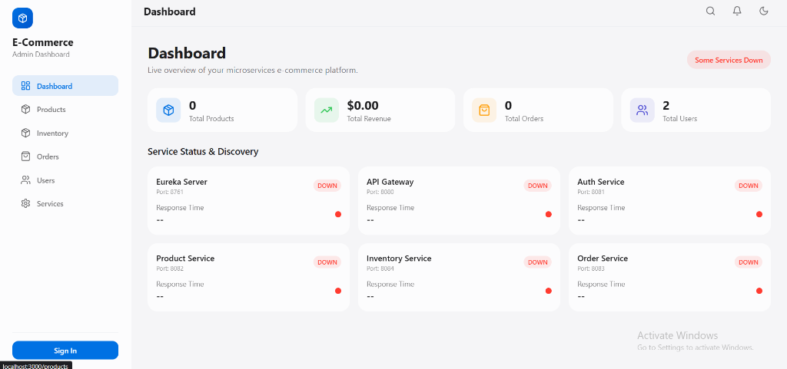
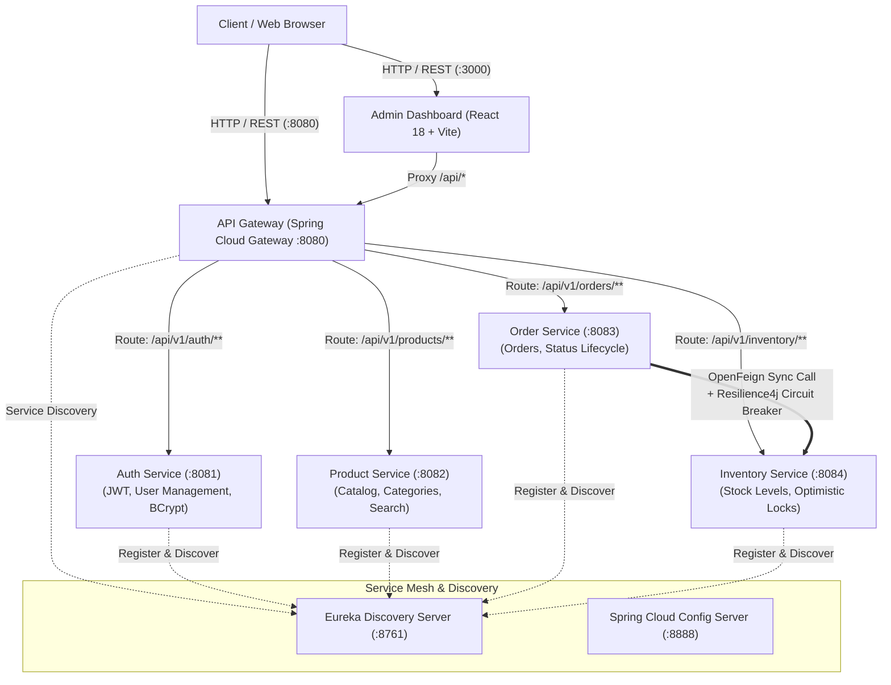

# Distributed E-Commerce Microservices Platform

[](https://adoptium.net/)
[](https://spring.io/projects/spring-boot)
[](https://spring.io/projects/spring-cloud)
[](https://react.dev/)
[](https://vitejs.dev/)
[](https://www.postgresql.org/)
[](https://resilience4j.readme.io/)
[](LICENSE)

A production-grade, enterprise distributed e-commerce platform built with **Domain-Driven Design (DDD)**, **Spring Boot 3**, **Spring Cloud**, **Resilience4j**, and a modern **React 18 + Vite** Admin Dashboard.

---

## 📸 Admin Dashboard Preview



---

## 🏛 Architecture Overview

The system is architected as an autonomous set of microservices adhering to bounded contexts, communicating asynchronously and synchronously through an API Gateway with centralized service discovery.



---

## 🌐 Network & Port Allocation

| Component | Port | Description | Tech Stack |
| :--- | :---: | :--- | :--- |
| **Admin Dashboard** | `3000` | Single Page Admin & Operations UI | React 18, Vite, Tailwind CSS, Framer Motion |
| **API Gateway** | `8080` | Central entry point, CORS, and JWT Header Propagation | Spring Cloud Gateway |
| **Auth Service** | `8081` | Identity, registration, authentication & RBAC | Spring Boot, Spring Security, JJWT |
| **Product Service** | `8082` | Product catalog bounded context | Spring Data JPA, H2 / PostgreSQL |
| **Order Service** | `8083` | Order processing & lifecycle management | OpenFeign, Resilience4j, Spring Data |
| **Inventory Service** | `8084` | Warehouse stock, reservations & optimistic locking | Spring Data JPA, `@Version` locking |
| **Eureka Server** | `8761` | Dynamic service registry & heartbeats | Netflix Eureka |
| **Config Server** | `8888` | Centralized external configuration repository | Spring Cloud Config |

---

## 🚀 Key Engineering Highlights

### 1. Centralized Security & JWT Header Propagation
- Requests pass through **Spring Cloud Gateway**, which validates stateless HMAC-SHA JWT signatures.
- Gateway parses user identity and role claims and mutates incoming downstream requests with `X-User-Id` and `X-User-Role` headers, allowing downstream services to stay stateless and avoid per-request DB auth lookups.

### 2. Resilient Inter-Service Communication
- **Order Service** coordinates with **Inventory Service** via declarative **Spring Cloud OpenFeign** clients.
- Wrapped in **Resilience4j Circuit Breakers**: If the Inventory Service experiences latency or failure, the circuit breaker opens and executes an automated fallback that safely rejects the order without data loss or cascading timeouts.

### 3. Concurrency & Overselling Prevention
- Inventory mutations leverage **Optimistic Concurrency Control** (`@Version` on `InventoryItem`).
- Ensures thread-safe stock reservations under high-concurrency order placement without heavy database table locks.

### 4. Reactive Health Monitoring
- The Admin Dashboard features real-time health checks querying `/actuator/health` across all microservices with live latency tracking and status indicators.

---

## ⚡ Quick Start

### Prerequisites
- **Java 17+** (JDK installed and on `PATH`)
- **Maven 3.8+**
- **Node.js 18+** & `npm`

### Option 1: 1-Click Launch (Windows)

To launch all 6 backend services and the frontend dashboard in dev mode:
```cmd
run-platform.bat
```
To shut down all services cleanly:
```cmd
shutdown-platform.bat
```

### Option 2: Run via Docker Compose (Containerized Production)

Build and package the JARs, then bring up the containerized services and PostgreSQL databases:
```bash
# 1. Package backend services
mvn clean package -DskipTests

# 2. Start PostgreSQL, Eureka, Gateway, and Microservices
docker compose up -d
```

### Option 3: Manual Step-by-Step

```bash
# 1. Start Eureka Service Registry
cd eureka-server && mvn spring-boot:run -Dspring-boot.run.profiles=dev

# 2. Start API Gateway
cd api-gateway && mvn spring-boot:run -Dspring-boot.run.profiles=dev

# 3. Start Business Microservices
cd auth-service && mvn spring-boot:run -Dspring-boot.run.profiles=dev
cd product-service && mvn spring-boot:run -Dspring-boot.run.profiles=dev
cd inventory-service && mvn spring-boot:run -Dspring-boot.run.profiles=dev
cd order-service && mvn spring-boot:run -Dspring-boot.run.profiles=dev

# 4. Start React Frontend
cd admin-dashboard
npm install
npm run dev
```

Visit the dashboard in your browser at: **`http://localhost:3000`**

---

## 🧪 Testing & Verification

Comprehensive test suites covering unit logic, Feign fallbacks, and boundary conditions:
```bash
# Run tests across all microservice modules
mvn test
```

---

## 📝 License
This project is open-source under the [MIT License](LICENSE).
