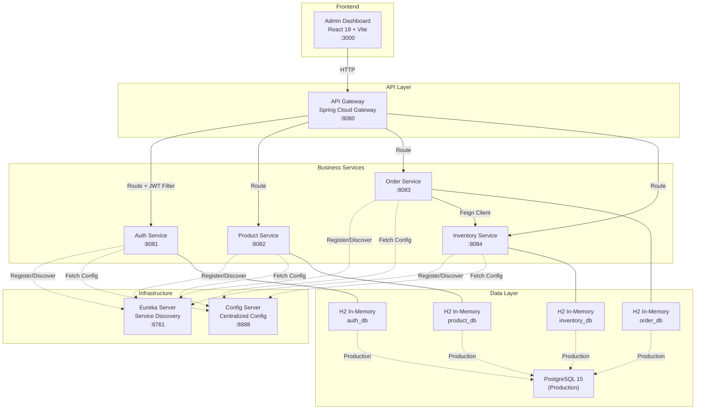
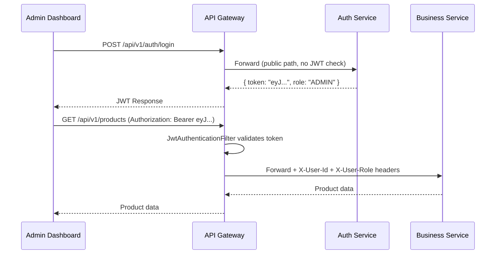
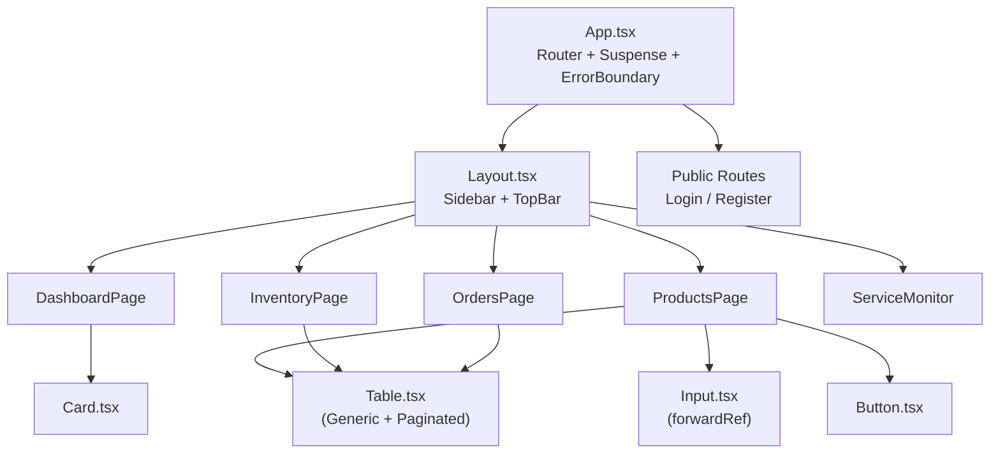

# E-Commerce Microservices Platform — Project Documentation

## Overview

A full-stack e-commerce platform built with **Spring Boot 3.2 microservices** on the backend and a **React 18 + Vite** admin dashboard on the frontend. The system follows a domain-driven, microservices architecture with service discovery, centralized configuration, an API gateway, and JWT-based authentication.

---

## Architecture Diagram



---

## Technology Stack

### Backend

| Layer | Technology | Version |
|---|---|---|
| Language | Java | 17 |
| Framework | Spring Boot | 3.2.5 |
| Cloud | Spring Cloud | 2023.0.1 |
| Service Discovery | Netflix Eureka | — |
| API Gateway | Spring Cloud Gateway | — |
| Config | Spring Cloud Config Server | — |
| Security | Spring Security + JJWT | 0.12.5 |
| ORM | Spring Data JPA / Hibernate | — |
| Migration | Flyway | 9.22.3 |
| Mapping | MapStruct | 1.5.5.Final |
| Resilience | Resilience4j | 3.1.0 |
| API Docs | SpringDoc OpenAPI | 2.3.0 |
| Dev DB | H2 (in-memory) | — |
| Prod DB | PostgreSQL | 15 |
| Build | Maven (multi-module reactor) | — |
| Containers | Docker Compose | — |

### Frontend

| Layer | Technology | Version |
|---|---|---|
| Framework | React | 18.x |
| Build Tool | Vite | — |
| Language | TypeScript | — |
| Styling | TailwindCSS | — |
| Data Fetching | @tanstack/react-query | — |
| Forms | react-hook-form + zod | — |
| HTTP | Axios | — |
| Routing | react-router-dom | — |
| Animations | framer-motion | — |
| Icons | lucide-react | — |
| Notifications | react-hot-toast | — |

---

## Project Structure

```
ecommerce-platform/
├── pom.xml                      # Parent POM (reactor build)
├── start-dev.sh                 # Dev startup script (all services + frontend)
├── stop-dev.sh                  # Dev shutdown script
├── docker/
│   ├── docker-compose.yml       # Full-stack Docker deployment
│   └── init-databases.sql       # PostgreSQL multi-DB init
│
├── common-lib/                  # Shared library
│   └── src/main/java/.../common/
│       ├── dto/PagedResponse.java
│       └── exception/           # Global exception handling
│
├── eureka-server/               # Service Discovery (:8761)
├── config-server/               # Centralized Configuration (:8888)
│   └── src/main/resources/shared/
│
├── api-gateway/                 # API Gateway (:8080)
│   └── src/main/java/.../gateway/
│       ├── config/SecurityConfig.java
│       └── filter/JwtAuthenticationFilter.java
│
├── auth-service/                # Authentication & Users (:8081)
│   └── src/main/java/.../auth/
│       ├── controller/AuthController.java
│       ├── domain/User.java, Role.java
│       ├── dto/RegisterRequest.java, LoginRequest.java, AuthResponse.java
│       ├── security/SecurityConfig.java, JwtTokenProvider.java
│       └── service/AuthService.java
│
├── product-service/             # Product Catalog (:8082)
│   └── src/main/java/.../product/
│       ├── controller/ProductController.java
│       ├── domain/Product.java
│       ├── mapper/ProductMapper.java (MapStruct)
│       └── service/ProductService.java
│
├── inventory-service/           # Stock Management (:8084)
│   └── src/main/java/.../inventory/
│       ├── controller/InventoryController.java
│       ├── domain/InventoryItem.java (with optimistic locking)
│       └── service/InventoryService.java
│
├── order-service/               # Order Processing (:8083)
│   └── src/main/java/.../order/
│       ├── controller/OrderController.java
│       ├── domain/Order.java, OrderItem.java
│       ├── client/InventoryClient.java (Feign)
│       └── service/OrderService.java
│
└── admin-dashboard/             # React Frontend (:3000)
    ├── package.json
    ├── vite.config.ts
    └── src/
        ├── api/index.ts         # Axios client + all API wrappers
        ├── components/          # Button, Card, Input, Table, Layout, ErrorBoundary
        ├── context/AuthContext.tsx
        ├── lib/queryClient.ts
        ├── pages/               # Dashboard, Products, Inventory, Orders, Services, Login, Register, NotFound
        └── types/index.ts       # TypeScript interfaces
```

---

## Microservices Detail

### Eureka Server (`:8761`)
Netflix Eureka service registry. All microservices register themselves here on startup and discover each other by application name (e.g., `AUTH-SERVICE`, `PRODUCT-SERVICE`).

### Config Server (`:8888`)
Spring Cloud Config Server using native file-based config. Provides shared configuration to all services. In dev mode, services disable config server integration (`spring.cloud.config.enabled: false`).

### API Gateway (`:8080`)
Spring Cloud Gateway that acts as the single entry point for all client requests.

**Routing rules:**
| Path Pattern | Target Service |
|---|---|
| `/api/v1/auth/**` | AUTH-SERVICE |
| `/api/v1/products/**` | PRODUCT-SERVICE |
| `/api/v1/inventory/**` | INVENTORY-SERVICE |
| `/api/v1/orders/**` | ORDER-SERVICE |

**Security:** A `JwtAuthenticationFilter` validates JWT tokens on every request (except public paths like `/api/v1/auth/**` and `/actuator/**`). On success, it injects `X-User-Id` and `X-User-Role` headers into the downstream request.

### Auth Service (`:8081`)
Handles user registration, login, profile discovery, and user role management.

**Endpoints:**
| Method | Path | Description |
|---|---|---|
| POST | `/api/v1/auth/register` | Register a new user (optional `role` field) |
| POST | `/api/v1/auth/login` | Login and receive a JWT |
| GET | `/api/v1/auth/me` | Get current authenticated user profile |
| GET | `/api/v1/auth/users` | List all registered users (ADMIN) |
| GET | `/api/v1/auth/users/count` | Total registered users count for dashboard |
| PUT | `/api/v1/auth/users/{id}/role` | Update user role (USER / ADMIN) |
| DELETE | `/api/v1/auth/users/{id}` | Delete user account |

**Security:** BCrypt password hashing. JWTs signed with HS512 using a shared secret. Tokens expire after 1 hour (3,600,000 ms).

**Domain:** `User` entity with fields: `id` (UUID), `username`, `email`, `password`, `role` (USER/ADMIN), `createdAt`, `updatedAt`.

### Product Service (`:8082`)
Full CRUD for the product catalog.

**Endpoints:**
| Method | Path | Description |
|---|---|---|
| GET | `/api/v1/products` | List products (paginated) |
| GET | `/api/v1/products/{id}` | Get product by ID |
| POST | `/api/v1/products` | Create product |
| PUT | `/api/v1/products/{id}` | Update product |
| DELETE | `/api/v1/products/{id}` | Delete product |

**Domain:** `Product` entity with fields: `id` (UUID), `sku`, `name`, `description`, `price`, `category`, `imageUrl`, `active`, `createdAt`, `updatedAt`. Enforces business invariants (e.g., price must be > 0).

### Inventory Service (`:8084`)
Manages stock levels with optimistic locking for concurrency safety.

**Endpoints:**
| Method | Path | Description |
|---|---|---|
| GET | `/api/v1/inventory` | List all inventory items |
| GET | `/api/v1/inventory/product/{productId}` | Get stock by product |
| POST | `/api/v1/inventory` | Set stock for a product |
| PUT | `/api/v1/inventory/{id}/adjust` | Adjust quantity |
| POST | `/api/v1/inventory/reserve` | Reserve stock (called by Order Service) |

**Domain:** `InventoryItem` with DDD-style mutators: `reserve(qty)`, `deduct(qty)`, `restock(qty)`. Uses `@Version` for optimistic locking.

### Order Service (`:8083`)
Manages customer orders. Communicates with Inventory Service via Feign.

**Endpoints:**
| Method | Path | Description |
|---|---|---|
| GET | `/api/v1/orders` | List orders (paginated) |
| GET | `/api/v1/orders/{id}` | Get order by ID |
| GET | `/api/v1/orders/stats` | Order statistics & revenue metrics |
| GET | `/api/v1/orders/recent` | Top 10 most recent orders |
| POST | `/api/v1/orders` | Create order (reserves inventory) |
| PATCH | `/api/v1/orders/{id}/status` | Update order status (PENDING, SHIPPED, etc.) |

**Domain:** `Order` aggregate with `OrderItem` children. Status enum: `PENDING → CONFIRMED → SHIPPED → DELIVERED / CANCELLED`. Enforces state-transition invariants.

**Inter-service call:** Uses `@FeignClient(name = "INVENTORY-SERVICE")` with `@CircuitBreaker` (Resilience4j) to call inventory reservation during order creation.

---

## Database Configuration

| Environment | Database | Strategy | Flyway |
|---|---|---|---|
| **Dev** (`-dev` profile) | H2 in-memory | `ddl-auto: update` | Disabled |
| **Production** (default) | PostgreSQL 15 | `ddl-auto: validate` | Enabled |

Each service has its own isolated database:
- `auth_db`, `product_db`, `inventory_db`, `order_db`

Flyway migrations live at `src/main/resources/db/migration/V1__init.sql` in each service.

---

## Security Architecture



> [!WARNING]
> **Hardcoded JWT Secret:** The signing key is currently hardcoded in `application.yml`. In production, this must be injected via environment variables or a secrets manager (e.g., HashiCorp Vault, AWS Secrets Manager).

> [!WARNING]
> **localStorage Token Storage:** The frontend stores JWTs in `localStorage`, which is vulnerable to XSS attacks. A more secure approach uses `HttpOnly` cookies set by the gateway.

---

## Frontend Dashboard

### Pages & Features

| Page | Route | Status | Description |
|---|---|---|---|
| Dashboard | `/` | ⚠️ Partial | Service health monitoring. Stats are **hardcoded**. |
| Products | `/products` | ✅ Complete | Full CRUD with search, filter, modal forms (react-hook-form + zod). |
| Inventory | `/inventory` | ⚠️ Partial | View stock, adjust quantities. Has N+1 API call problem. |
| Orders | `/orders` | ⚠️ Partial | List orders, detail drawer. Has N+1 API call problem. |
| Services | `/services` | ✅ Complete | Real-time health pings to all microservices. |
| Login | `/login` | ✅ Complete | Form with validation and JWT persistence. |
| Register | `/register` | ✅ Complete | Form with validation, supports role assignment. |
| 404 | `*` | ✅ Complete | Catch-all not found page. |

### UI Design System
- **Apple-inspired** glassmorphism theme with `backdrop-blur`, subtle gradients, and micro-animations via `framer-motion`.
- Reusable components: `Button`, `Card`, `Input` (with `forwardRef`), `Table` (generic typed), `Layout` (sidebar + topbar), `ErrorBoundary`.
- **Color palette:** Apple Blue (`#0071E3`), Apple Gray (`#F5F5F7`), system grays.

### Component Architecture


---

## Development Scripts

### Starting the Platform
```bash
./start-dev.sh
```
This script:
1. Checks Java 17 and Maven are installed
2. Launches all 7 Java microservices with `mvn spring-boot:run -Dspring-boot.run.profiles=dev`
3. Waits 45 seconds for boot-up
4. Starts the frontend with `npm run dev`
5. Reports service health status
6. Keeps running via `wait` (so background processes stay alive)

### Stopping the Platform
```bash
./stop-dev.sh
```
Reads `./logs/services.pid` and gracefully kills all processes. Falls back to port-based cleanup.

### Docker (Production-like)
```bash
cd docker && docker-compose up -d
```
Spins up PostgreSQL, Zipkin, all microservices, and the frontend.

---

## API Quick Reference

### Authentication
```bash
# Register a regular user
curl -X POST http://localhost:8080/api/v1/auth/register \
  -H "Content-Type: application/json" \
  -d '{"username":"user1","email":"user@example.com","password":"password123"}'

# Register an admin
curl -X POST http://localhost:8080/api/v1/auth/register \
  -H "Content-Type: application/json" \
  -d '{"username":"admin1","email":"admin@example.com","password":"password123","role":"ADMIN"}'

# Login
curl -X POST http://localhost:8080/api/v1/auth/login \
  -H "Content-Type: application/json" \
  -d '{"username":"admin1","password":"password123"}'
```

### Products (requires JWT)
```bash
TOKEN="eyJ..."

# List products
curl http://localhost:8080/api/v1/products -H "Authorization: Bearer $TOKEN"

# Create product
curl -X POST http://localhost:8080/api/v1/products \
  -H "Authorization: Bearer $TOKEN" \
  -H "Content-Type: application/json" \
  -d '{"sku":"SKU001","name":"Widget","description":"A widget","price":29.99,"category":"Electronics"}'
```

### Inventory (requires JWT)
```bash
# Set stock
curl -X POST http://localhost:8080/api/v1/inventory \
  -H "Authorization: Bearer $TOKEN" \
  -H "Content-Type: application/json" \
  -d '{"productId":"<product-uuid>","quantity":100}'
```

### Orders (requires JWT)
```bash
# Create order
curl -X POST http://localhost:8080/api/v1/orders \
  -H "Authorization: Bearer $TOKEN" \
  -H "Content-Type: application/json" \
  -d '{"customerId":"<user-uuid>","items":[{"productId":"<product-uuid>","quantity":2,"unitPrice":29.99}]}'
```
